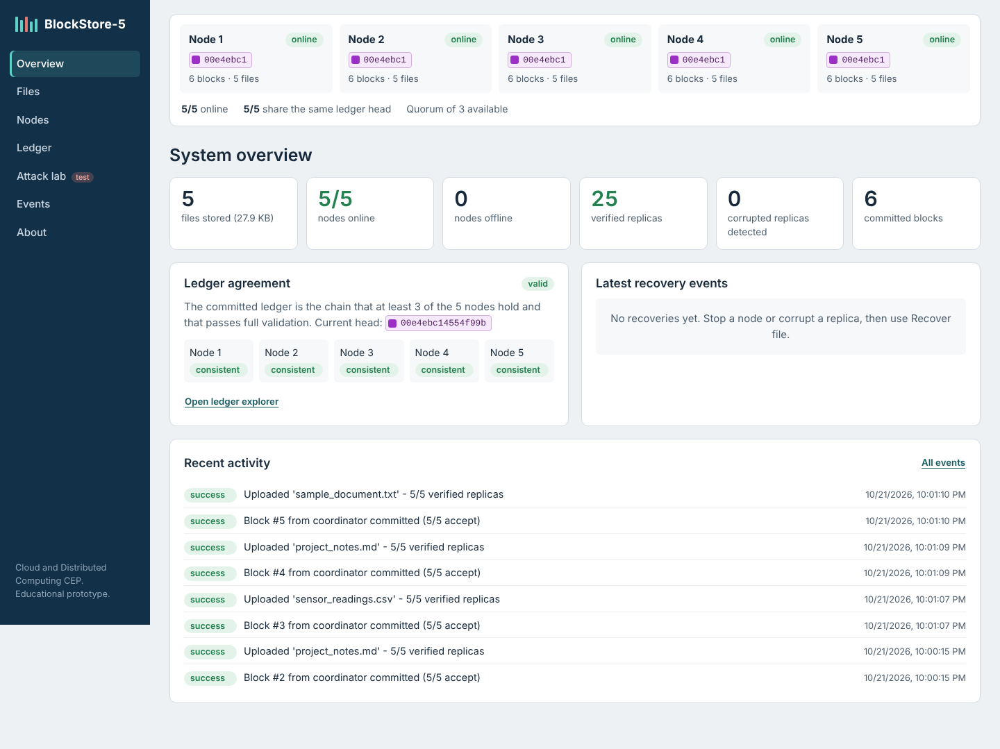
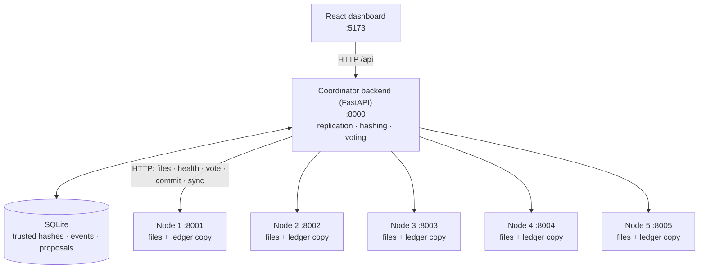

# BlockStore-5

**A distributed file storage, fault-tolerance and blockchain integrity verification system**
Cloud and Distributed Computing (CDC) — Complex Engineering Problem (CEP), educational prototype.



## 1. Problem

A single storage server is a single point of failure: if it stops, files become unavailable; if its copy is
corrupted or maliciously changed, nobody notices. Replication improves availability, but replication alone does
not tell you which copy is trustworthy.

BlockStore-5 stores every file on **five independent storage nodes**, records the file's **SHA-256 hash** at upload
time, detects tampered or missing replicas, recovers verified copies from honest nodes, and keeps a small
**hash-linked ledger** on every node whose blocks are committed only when **at least 3 of 5 nodes vote yes**.

> This is a teaching prototype. It is **not** production-grade Byzantine fault tolerance. See
> [docs/limitations.md](docs/limitations.md).

## 2. Objectives

1. Run five independent node services that communicate over real HTTP.
2. Replicate uploads to all five nodes and verify every returned copy by hash.
3. Detect node failure and keep serving files from healthy nodes, returning only verified copies.
4. Detect a tampered replica on one node while the other four stay valid, and repair it.
5. Keep a per-node educational blockchain; commit records with a 3-of-5 signed majority vote.
6. Show that honest nodes reject an invalid block proposed by a malicious node.
7. Present everything on a live dashboard that reflects real system state.

## 3. Features

| Area | What you can do |
|---|---|
| Files | Upload, preserve immutable linked versions, list/download each version, recover and repair |
| Organizations | Login as one of four configured organizations; owner-controlled read sharing, revocation, and role-gated administration |
| Replication | 5 replicas, per-node hash check on write, honest partial-failure reporting, write quorum of 3 |
| Integrity | Coordinator downloads each copy and recalculates SHA-256 itself; node's own claim shown but not trusted |
| Fault tolerance | Health checks every 2 s, automatic `NODE_FAILURE` / `NODE_REJOINED` records, ledger catch-up after restart |
| Blockchain | Genesis block, SHA-256 block hashes, previous-hash links, 8 transaction types, full semantic validation of all 5 copies |
| Consensus | Real votes from the 5 services, HMAC-signed, registered identities only, one vote per node, quorum 3 |
| Attack lab | Malicious mode (opt-in, reversible), corrupt a replica, 3 kinds of invalid block, tamper a local ledger copy |
| Audit | Event log in SQLite + every proposal with all votes and ledger heads before/after |

## 4. Technology stack

| Component | Technology |
|---|---|
| Frontend | React 19 + Vite, plain CSS |
| Backend (coordinator) | Python 3.12+, FastAPI, Pydantic, `requests` |
| Storage nodes | Python, FastAPI (5 separate services) |
| Integrity | SHA-256 (`hashlib`) |
| Blockchain | Custom educational module `shared/blockcore.py` |
| Vote authentication | HMAC-SHA256 with a per-node secret |
| Metadata | SQLite |
| Deployment | Docker + Docker Compose (or 5 separate local processes) |
| Tests | Pytest, Node's built-in test runner |
| API docs | FastAPI Swagger UI at `/docs` |

Everything is free and runs offline on one computer. No cloud account, no API keys, no cryptocurrency.

## 5. Architecture



Details, protocols and the trust model: [docs/architecture.md](docs/architecture.md).

## 6. Folder structure

```text
BlockStore-5/
├── shared/blockcore.py          blockchain rules shared by backend and nodes (hashing, validation, vote signing)
├── storage_node/node_app/       one node service, run 5 times
│   ├── main.py                  HTTP endpoints
│   ├── storage.py               this node's file replicas
│   ├── ledger.py                this node's ledger copy (ledger.json)
│   ├── consensus.py             how the node votes; invalid blocks for the malicious test
│   ├── health.py                simulated-failure / malicious flags (in memory)
│   └── config.py
├── backend/app/                 coordinator
│   ├── api/                     REST routes: authentication, files, nodes, blockchain, simulation, dashboard
│   ├── services/                file_service (upload/verify/recover), node_client (HTTP), health_monitor
│   ├── blockchain/              consensus (propose/vote/tally/commit), ledger_view (majority ledger)
│   ├── database/db.py           SQLite schema and helpers
│   ├── models/schemas.py        Pydantic request models
│   └── main.py
├── backend/tests/               unit + live integration tests
├── frontend/src/                React dashboard (pages, components, services/api.js)
├── frontend/tests/              API error-handling tests
├── scripts/smoke_test.py        end-to-end check of a running system
├── scripts/benchmark.py         performance measurements
├── run_local.py                 start/stop the 6 services without Docker
├── docker-compose.yml
├── docs/                        architecture, setup, testing, limitations, viva, report, screenshots, results
└── sample_files/
```

## 7. Installation and start-up

Full instructions with Windows PowerShell commands and troubleshooting: [docs/setup.md](docs/setup.md).
Before using the dashboard, configure the initial organization accounts as described there. There are no built-in
default user passwords.

**Option A — Docker Compose (recommended)**

```bash
docker compose up --build -d
# Dashboard   http://localhost:5173
# API docs    http://localhost:8000/docs
docker compose stop node2      # real node failure
docker compose start node2     # node comes back and re-syncs
docker compose down            # stop (keeps data);  docker compose down -v  also deletes data
```

**Option B — complete local run on Windows (no Docker required)**

Open PowerShell in the `BlockStore-5` project folder. Install the backend and frontend dependencies once:

```powershell
python -m venv .venv
.\.venv\Scripts\python.exe -m pip install -r backend\requirements.txt
Push-Location frontend
npm install
Pop-Location
```

Start the backend and its five storage nodes in the first PowerShell window:

```powershell
.\.venv\Scripts\python.exe run_local.py start
```

Keep that window open. In a second PowerShell window, open the same project folder and start the dashboard:

```powershell
Set-Location frontend
npm run dev
```

Open **http://localhost:5173**. The API documentation is at **http://localhost:8000/docs**. Check the backend at
**http://localhost:8000/api/health** and node health at `http://localhost:8001/health` through
`http://localhost:8005/health`.

To check the full local system, open a third PowerShell window at the project folder:

```powershell
.\.venv\Scripts\python.exe scripts\smoke_test.py --mode local
```

To stop the dashboard, press **Ctrl+C** in its window. Then stop the five nodes and backend from the first window:

```powershell
.\.venv\Scripts\python.exe run_local.py stop
```

Local-mode node failure/recovery commands are `.\.venv\Scripts\python.exe run_local.py stop-node node2` and
`.\.venv\Scripts\python.exe run_local.py start-node node2`. From the project folder, run backend tests with
`.\.venv\Scripts\python.exe -m pytest -v backend`; run frontend tests with `npm test` from `frontend`.
More setup and troubleshooting details are in [docs/setup.md](docs/setup.md).

## 8. API summary

Interactive documentation: **http://localhost:8000/docs**

| Method & path | Purpose |
|---|---|
| `GET /api/auth/organizations` · `POST /api/auth/login` · `GET /api/auth/me` · `POST /api/auth/logout` | Organization login/session |
| `GET /api/health` · `GET /api/dashboard` · `GET /api/events` | Public health; authenticated organization-scoped overview/events |
| `POST /api/files/upload` · `POST /api/files/{id}/versions?expected_version=N` | Upload a document / create next immutable version |
| `GET /api/files` · `GET /api/files/{id}` | List versions / details |
| `GET /api/files/{id}/replicas` | Live replica check (not recorded) |
| `POST /api/files/{id}/verify` | Integrity check, recorded on the ledger |
| `GET /api/files/{id}/download` | Verified copy (`X-BlockStore-Source-Node` header) |
| `POST /api/files/{id}/recover` | Verified copy + repair bad/missing replicas |
| `GET /api/nodes` · `/api/nodes/{id}/health` · `/files` · `/ledger` | Node monitoring |
| `GET /api/blockchain/blocks` · `GET /api/blockchain/validate` | Committed ledger, validation of all 5 copies |
| `POST /api/blockchain/propose` · `GET /api/blockchain/proposals/{id}` | Manual proposal, vote details |
| `POST /api/blockchain/repair` | Re-sync inconsistent ledger copies from the majority |
| `POST /api/simulation/node-failure` · `node-restart` | **Test:** simulated (HTTP 503) failure on/off |
| `POST /api/simulation/malicious-node` | **Test:** malicious mode on/off |
| `POST /api/simulation/corrupt-replica` | **Test:** change one node's copy (`confirm: true`) |
| `POST /api/simulation/invalid-block` | **Test:** malicious node proposes an invalid block |
| `POST /api/simulation/tamper-ledger` | **Test:** edit a past block in one node's ledger file |

## 9. Sample usage (presentation script)

See [docs/demo_script.md](docs/demo_script.md) for a 10-minute step-by-step demo.

## 10. Results

* Latest checks: **45 backend tests**, **6 frontend tests**, and a passing production frontend build. These do not
  replace a configured live-deployment smoke test (see [docs/TEST_REPORT.md](docs/TEST_REPORT.md)).
* Measured performance: [docs/results/benchmark.md](docs/results/benchmark.md).
* Genuine screenshots of the running system: [docs/screenshots/](docs/screenshots/).

## 11. Troubleshooting

| Problem | Fix |
|---|---|
| Port 8000–8005 or 5173 already in use | Stop the other program, or change the host port in `docker-compose.yml` (`"9001:8000"`) |
| Dashboard shows "cannot reach the coordinator" | Backend not running: `docker compose ps` / `python run_local.py status` |
| Upload says fewer than 3 nodes | Start the stopped nodes; writes need a quorum of 3 |
| Node shows "behind" | It missed blocks while offline; it is caught up automatically within a few seconds |
| Node shows "invalid" after the tamper test | Ledger page → **Repair inconsistent copies** |
| Start over with empty data | `docker compose down -v` or `python run_local.py reset` |

## 12. Limitations

Coordinator is a single point of failure and is trusted; consensus is a simplified coordinator-based majority vote,
not BFT; one proposal at a time; no partition handling; hash links make tampering detectable, not impossible; five
replicas improve availability but are not a backup; local demo does not prove geographic fault tolerance.
Full list: [docs/limitations.md](docs/limitations.md).

## 13. Documentation index

| File | Contents |
|---|---|
| [docs/architecture.md](docs/architecture.md) | Components, protocols, trust model, diagrams |
| [docs/setup.md](docs/setup.md) | Installation (Windows / Linux / macOS), URLs, health checks, troubleshooting |
| [docs/testing.md](docs/testing.md) | Test report with actual results |
| [docs/limitations.md](docs/limitations.md) | Simplifications and limitations |
| [docs/viva_questions.md](docs/viva_questions.md) | 30 viva questions with answers |
| [docs/demo_script.md](docs/demo_script.md) | Presentation script |
| [docs/CEP_Report.docx](docs/CEP_Report.docx) / [.md](docs/CEP_Report.md) | Editable CEP report |
