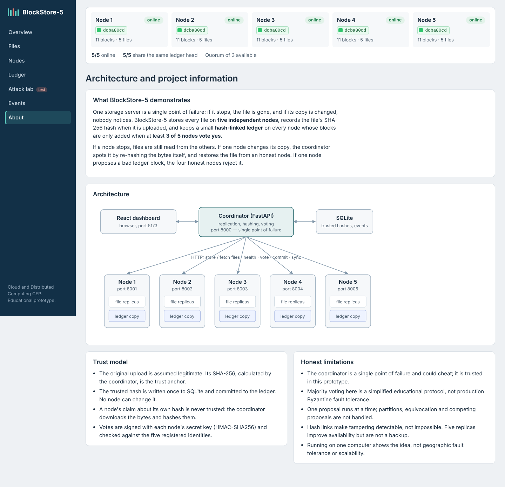
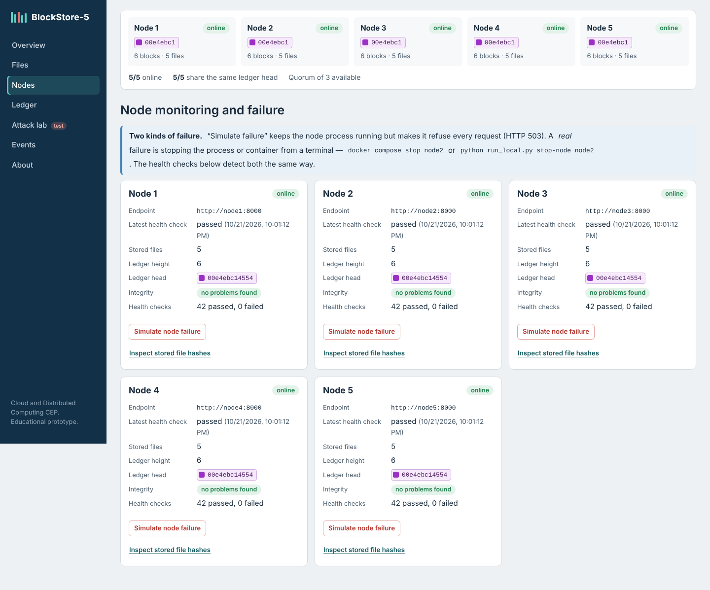
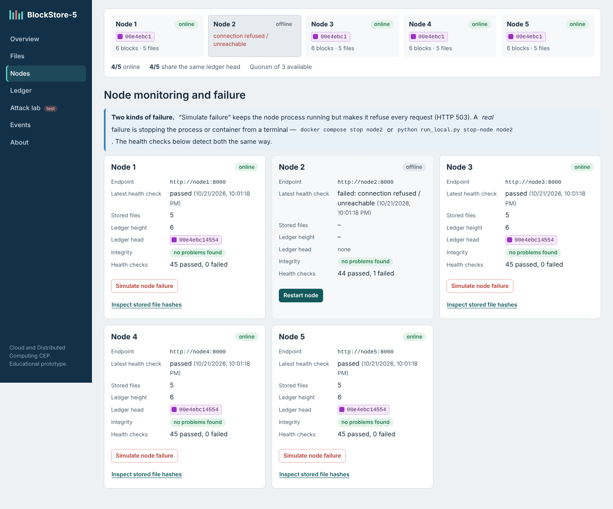
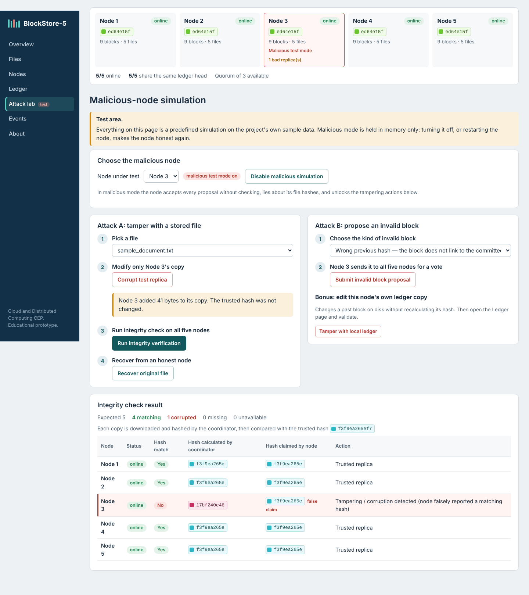
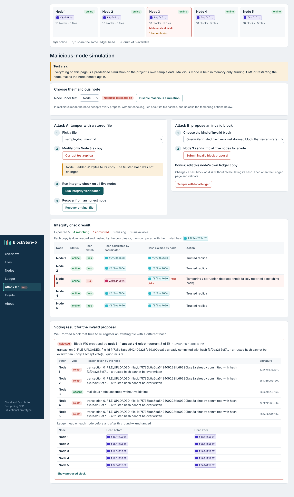
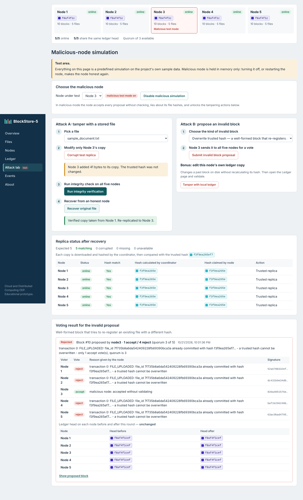

# Abstract

Single-server file storage fails completely when that server stops and cannot tell when its copy has been
corrupted or changed. This project designs, implements and evaluates BlockStore-5, a small distributed storage
system in which every file is replicated to five independent storage nodes running as separate services that
communicate over HTTP. A coordinator records each file's SHA-256 hash at upload time as the trust anchor,
re-hashes replicas itself to detect tampering, and serves or restores only copies that match the trusted hash.
Every node keeps a copy of a small educational blockchain whose blocks are committed only when at least three of
the five nodes return valid, signed accept votes. A controlled malicious-node simulation shows two different
attacks: tampering with one stored replica, which is detected while four honest copies remain valid and are used
for repair; and proposing invalid ledger blocks, which the four honest nodes reject, leaving the ledger unchanged.
Automated tests (37 backend, 5 frontend) and a Docker smoke test passed, and measured operation times for files
from 1 KB to 5 MB were between about 80 ms and 400 ms on a two-core virtual machine. The prototype is an educational
demonstration of replication, fault tolerance, hash-based integrity and honest-majority voting; it is not a
production-grade Byzantine fault-tolerant system.

# 1. Introduction

Cloud storage services such as object stores keep several copies of data on different machines so that the
failure of one machine does not make data unavailable. Replication alone, however, does not say which copy is
correct if copies disagree. Blockchains add a tamper-evident, replicated log that several parties agree on.
BlockStore-5 combines these ideas in a project small enough for a student to build and explain: five storage
nodes, replication, SHA-256 integrity checks, failure detection and recovery, and a simple majority-voted ledger,
all shown on a live dashboard.

# 2. Problem statement

A single storage server is a single point of failure: when it is unavailable, its files are inaccessible, and a
corrupted or maliciously modified file may go unnoticed. A replicated system improves availability but cannot by
itself guarantee that every copy is trustworthy. The problem is to build a system that (i) keeps files available
when a node fails, (ii) detects a corrupted or tampered replica and recovers a verified copy, and (iii) keeps an
auditable record that honest nodes agree on and that a single malicious node cannot change.

# 3. Objectives

1. Implement five independent storage node services communicating over a real network protocol (HTTP).
2. Replicate uploaded files to all five nodes and verify every replica by SHA-256.
3. Detect node failure and continue to serve verified copies from healthy nodes; re-synchronise restarted nodes.
4. Detect a tampered replica on one node while the four unchanged replicas remain valid, and repair it.
5. Implement an educational blockchain on every node and a 3-of-5 majority vote for committing records.
6. Demonstrate that honest nodes reject invalid ledger proposals from a malicious node.
7. Provide a dashboard showing real system state, automated tests, measurements and documentation.

# 4. Scope

**In scope:** local deployment (Docker Compose or five local processes), files up to 10 MB, full replication on
five nodes, one coordinator, one faulty or malicious node at a time, predefined attack simulations on sample data.

**Out of scope:** user accounts and authentication, encryption, geographic distribution, production consensus
(Raft, PBFT), automatic re-replication, versioned backups, public blockchains or cryptocurrency.

# 5. Requirements

**Functional:** upload with name/type/size validation; trusted SHA-256; replication with honest partial-failure
reporting; listing and details; verified download; integrity verification per node; recovery and repair; node
health monitoring; simulated and real node failure and restart; per-node ledger with genesis, linked blocks and
seven transaction types; ledger validation and agreement check; signed majority voting with quorum 3; malicious
mode, replica corruption, invalid block proposals; event log; REST API with documentation.

**Non-functional:** free and offline; beginner-readable modular code; timeouts on all node calls; meaningful HTTP
status codes and error messages; responsive accessible dashboard; reproducible tests; honest reporting of
limitations.

# 6. System architecture

The system has seven services. The **React dashboard** calls the **coordinator backend** (FastAPI, port 8000),
which stores trusted metadata, the event log and every consensus round in **SQLite**. The coordinator talks over
HTTP to **five storage nodes** (ports 8001–8005). Each node is a separate FastAPI service with its own identity,
secret key, data volume, file replicas and `ledger.json`. The blockchain rules (hashing, block and transaction
validation, vote signing) are in one shared module so that every node applies exactly the same rules.

| Layer | Responsibility |
|---|---|
| Frontend | Seven pages: overview, files, nodes, ledger, attack lab, events, about; polls the API every 2–5 s |
| Coordinator API | `files`, `nodes`, `blockchain`, `simulation`, `dashboard` routers |
| Coordinator services | `file_service` (upload/verify/download/recover), `node_client` (HTTP + timeouts), `health_monitor` |
| Coordinator blockchain | `consensus` (propose, vote, tally, commit), `ledger_view` (majority ledger and per-node state) |
| Node | `storage`, `ledger`, `consensus` (voting), `health` (flags), `main` (endpoints) |

The coordinator is deliberately a single point of failure in this prototype, which keeps the protocol simple to
explain; this is discussed in Section 13.

# 7. Implementation methodology

The work followed eight phases: (1) environment inspection and design; (2) storage node service; (3) coordinator
upload, replication, monitoring and recovery; (4) blockchain and voting; (5) simulations; (6) dashboard;
(7) testing and debugging; (8) documentation. Each phase was checked against running services before the next.

**Upload.** The coordinator validates the file, computes its SHA-256, creates a 128-bit random file id, sends the
bytes to all five nodes in parallel, and accepts a replica only if the hash returned by the node equals the trusted
hash. With fewer than three verified replicas the upload is rolled back. Otherwise the metadata is stored once and a
block containing `FILE_UPLOADED` and `FILE_REPLICATED` is put to the vote. Missing replicas are reported, not hidden.

**Integrity check.** For every node the coordinator downloads the replica and recomputes SHA-256, and separately
asks the node which hash it claims. Each replica is classified as match, mismatch, missing or unavailable, and an
`INTEGRITY_CHECKED` record (plus `MALICIOUS_ACTIVITY_DETECTED` per mismatch) is committed.

**Download and recovery.** Nodes are tried in turn and the first copy whose recomputed hash equals the trusted hash
is returned; otherwise HTTP 503. Recovery additionally re-uploads the verified copy to online nodes with missing or
mismatched replicas, re-verifies all five and commits `FILE_RECOVERED`.

**Failure detection.** A background thread polls `/health` on all nodes every 2 s. A change from online to offline
commits `NODE_FAILURE`; from offline to online the node's ledger is synchronised and `NODE_REJOINED` is committed.
Two kinds of failure are supported and labelled separately: an application-level simulated failure (the node
answers HTTP 503) and a real failure (the container or process is stopped from a terminal). The application exposes
no shell or Docker control.

**Blockchain and voting.** Described in Section 9.

**Simulation.** Malicious mode is an in-memory flag on one node (default Node 3), reversible by switching it off or
restarting the node. In this mode the node accepts every proposal without checking, reports false hashes, and allows
three test actions: corrupt its replica, build an invalid block, or edit its own ledger file. Destructive actions
require explicit confirmation.

# 8. Distributed computing concepts applied

| Concept | Where it appears |
|---|---|
| Independent nodes, message passing | Five services, HTTP only, separate volumes |
| Replication | Five full copies per file |
| Availability | Reads continue with up to four nodes down if one verified copy exists |
| Fault tolerance | Writes and commits continue with any three nodes |
| Failure detection | Periodic health checks with timeouts |
| Quorum | 3 of 5 for writes and ledger commits; two majorities always overlap |
| Consistency | Same block order on all honest nodes; offline nodes catch up (eventual consistency) |
| Recovery | Verified re-replication from an honest copy; ledger sync and repair |
| Single point of failure | The coordinator, documented |

# 9. Blockchain concepts applied

Each block contains index, timestamp, previous hash, transactions, proposer and its own hash, computed as SHA-256
of the canonical JSON of the other fields. The genesis block has fixed contents, so all five nodes produce the
same genesis hash. Transactions contain metadata only (file id, name, size, expected hash, node ids, outcome,
timestamp); transactions over 2 KB or containing file contents are rejected.

An honest node accepts a proposed block only if its index is the next height, its previous hash equals the node's
head, its stored hash equals the recomputed hash, its proposer is registered and all transactions are valid. A
semantic rule prevents a second `FILE_UPLOADED` for an existing file id, so the trusted hash cannot be overwritten
through the ledger.

The voting round is: propose → all five nodes validate and return a vote signed with HMAC-SHA256 using their own
secret → the coordinator counts only votes from registered identities with valid signatures for this block, one per
node → with at least three accepts the block is sent to every node, which validates it again before appending.
Every round is stored with all votes, the reason for each, and the ledger heads before and after. The full chain of
every node can be validated (sequential indexes, recomputed hashes, previous-hash links, genesis) and compared with
the majority.

This is a simplified, coordinator-based protocol: it demonstrates the honest-majority principle with one faulty node
but is not a proven Byzantine fault-tolerant algorithm.

# 10. Testing and results

## 10.1 Automated tests

All 17 required behaviours are covered by automated tests: 11 blockchain unit tests, 6 vote-tally unit tests and
20 integration tests that start five real node processes and the backend on separate ports (37 in total, all
passed), plus 5 frontend error-handling tests (all passed). The integration tests include really terminating and
restarting a node process. A separate smoke test passed against the Docker Compose deployment, including
`docker compose stop node2` and `docker compose start node2`. The full test table is in `docs/testing.md`.

Note on environment: the development machine had no access to package registries, so the Docker images were
built on a locally assembled stand-in base image and the frontend container was not built there; all other parts
ran unchanged. On a normal machine, `docker compose up --build` performs the real package installation.

## 10.2 Demonstration results

## 10.3 Performance evaluation

Measured with `scripts/benchmark.py` against the Docker deployment (five node containers and the backend on a
Linux VM with 2 vCPU and 8 GB RAM), 3 runs per size, times in milliseconds as mean (min–max):

| File size | Upload (client) | Upload (server) | Replication to 5 nodes | Ledger vote + commit | Integrity verification | Recovery of 1 corrupted replica |
|---|---|---|---|---|---|---|
| 1 KB | 89.4 (78.4–99.6) | 85.6 (75.7–94.1) | 11.4 (10.4–13.3) | 61.6 (56.0–65.4) | 85.9 (80.5–94.9) | 114.1 (103.1–120.3) |
| 100 KB | 103.9 (89.8–120.4) | 100.2 (85.9–117.0) | 12.6 (11.6–13.7) | 73.2 (56.9–90.1) | 90.6 (86.4–96.2) | 111.8 (110.7–113.2) |
| 1 MB | 132.9 (127.3–138.8) | 123.1 (119.4–125.2) | 29.6 (22.9–35.3) | 77.2 (69.5–88.8) | 130.8 (126.8–134.4) | 186.1 (150.5–217.8) |
| 5 MB | 227.0 (197.5–254.4) | 191.7 (178.3–200.9) | 90.6 (74.9–101.2) | 81.4 (74.9–88.9) | 195.9 (188.1–210.6) | 382.2 (338.2–414.3) |

Valid replicas of a test file were 5 before, 4 during and 5 after a simulated failure of Node 2; the download
during the failure was served (verified) by Node 1. Over the run the coordinator recorded 67–69 successful health
checks per node and 0–2 failed checks, the failures corresponding to the deliberate failure tests.

**Observations.** For small files the ledger vote and commit dominates (about 60–80 ms), because each round reads
the five ledger copies, collects five votes and sends five commits. Replication cost grows with file size (11 ms
for 1 KB to 91 ms for 5 MB, five copies in parallel). Recovery costs roughly a verification plus a repair plus a
second verification. These numbers come from a single local machine and do not represent real network latency.

**Trade-offs.** More replicas raise availability but multiply storage (5× here) and network traffic. Hashing detects
changes but does not identify the attacker. The ledger improves auditability but provides neither confidentiality
nor availability by itself. The coordinator simplifies the protocol but is a single point of failure.

# 11. Limitations

1. The coordinator is a single point of failure and is trusted.
2. The consensus is a simplified coordinator-based majority vote, not BFT; it does not handle partitions,
   equivocation, coordinator failure or concurrent proposals (one round at a time).
3. At most one faulty node is assumed; three honest nodes must be online for writes.
4. HMAC vote tags can be checked by the coordinator but not by other nodes.
5. Hash links make tampering detectable, not impossible; a mismatch does not identify its cause.
6. No authentication, authorisation, encryption or TLS; demo secrets must be changed for any real use.
7. Full replication uses five times the storage; replicas are not backups.
8. All nodes run on one computer, so geographic fault tolerance and scalability are not demonstrated.

# 12. Future improvements

Replace the coordinator with a replicated leader using Raft, or with PBFT among the nodes; use Ed25519 signatures so
nodes can verify each other; add user authentication, TLS and encryption at rest; use erasure coding instead of full
copies; re-replicate automatically when a node returns; add versioning and off-site backups; deploy the nodes on
separate machines or cloud regions and measure under real network conditions.

# 13. Conclusion

BlockStore-5 meets its objectives as an educational prototype. Five independent node services store replicated
files; a node failure is detected within seconds and verified copies continue to be served; a tampered replica on
one node is detected by re-hashing, never served, and repaired from an honest node; and a three-of-five signed vote
keeps the per-node ledgers in agreement while rejecting invalid blocks from a malicious node. The project also makes
the limits of these techniques clear: replication is not backup, hashing is detection rather than prevention, and a
coordinator-based majority vote is a teaching model rather than production Byzantine fault tolerance.

# 14. References

1. A. S. Tanenbaum and M. van Steen, *Distributed Systems*, 3rd ed., 2017.
2. G. Coulouris, J. Dollimore, T. Kindberg and G. Blair, *Distributed Systems: Concepts and Design*, 5th ed., Addison-Wesley, 2011.
3. National Institute of Standards and Technology, *FIPS 180-4: Secure Hash Standard (SHS)*, 2015.
4. H. Krawczyk, M. Bellare and R. Canetti, *RFC 2104: HMAC: Keyed-Hashing for Message Authentication*, IETF, 1997.
5. S. Nakamoto, "Bitcoin: A Peer-to-Peer Electronic Cash System," 2008.
6. M. Castro and B. Liskov, "Practical Byzantine Fault Tolerance," in *Proc. OSDI*, 1999.
7. D. Ongaro and J. Ousterhout, "In Search of an Understandable Consensus Algorithm (Raft)," in *Proc. USENIX ATC*, 2014.
8. L. Lamport, R. Shostak and M. Pease, "The Byzantine Generals Problem," *ACM TOPLAS*, vol. 4, no. 3, 1982.
9. P. Mell and T. Grance, *NIST SP 800-145: The NIST Definition of Cloud Computing*, 2011.
10. FastAPI documentation, https://fastapi.tiangolo.com; React documentation, https://react.dev; Docker Compose documentation, https://docs.docker.com/compose/.
