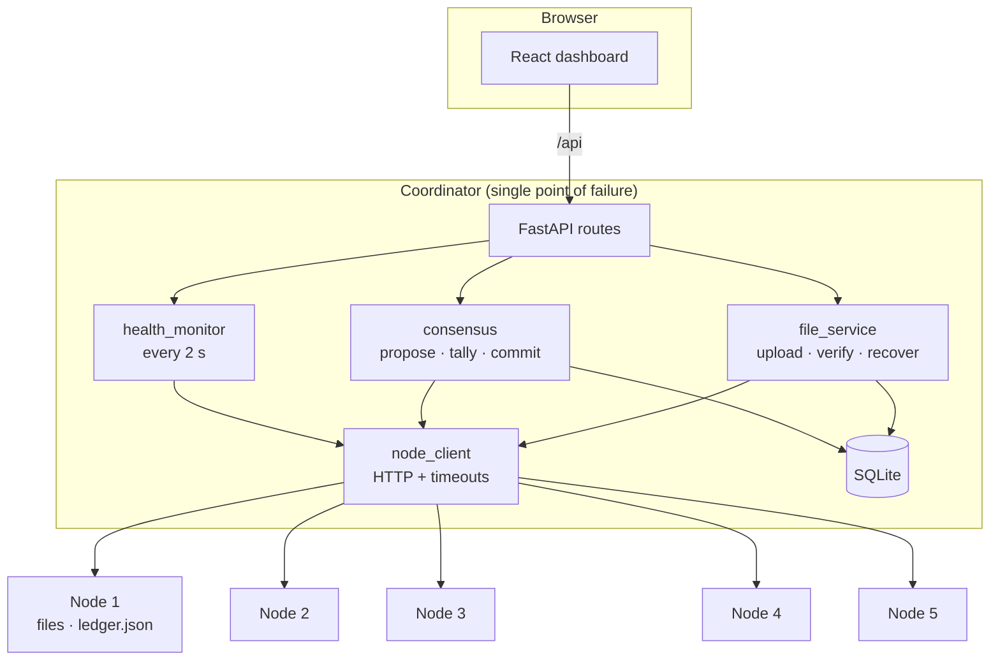
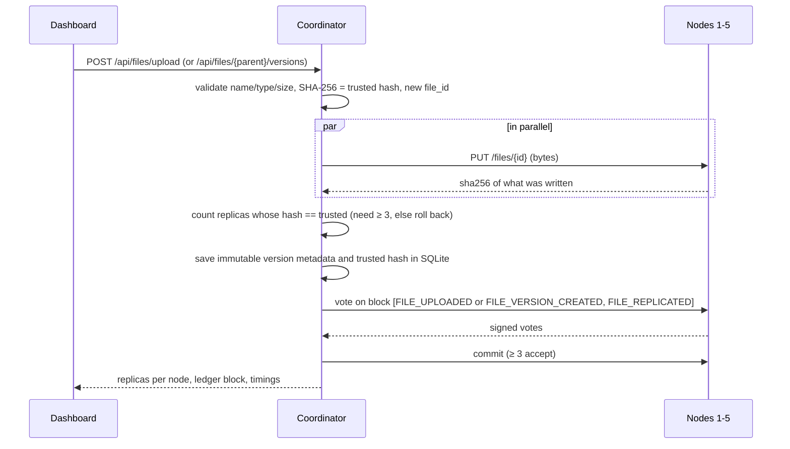

# Architecture

## 1. Components

| Component | Process / container | Port | State it owns |
|---|---|---|---|
| Frontend | React app (Vite dev server, or nginx in Docker) | 5173 | none — reads everything from the API |
| Coordinator backend | FastAPI | 8000 | SQLite: trusted hashes, document-version lineage, organization accounts/shares, replica checks, events, proposals |
| Node 1 … Node 5 | 5 separate FastAPI services | 8001–8005 (8000 inside Docker) | its own `files/` folder and `ledger.json` in its own volume |

The nodes never share memory or disk. In Docker each node is its own container with its own named volume
(`node1-data` … `node5-data`) on the `blockstore` bridge network; in local mode each is its own operating-system
process with its own folder under `runtime/`. All communication is HTTP with timeouts.

## 2. Node HTTP interface

| Endpoint | Used for |
|---|---|
| `GET /health` | public node health: id, file count, ledger height and head hash |
| `PUT /files/{id}` · `GET /files/{id}` · `DELETE /files/{id}` | coordinator-controlled replica writes/reads/rollback |
| `GET /files/{id}/hash` · `GET /files` | coordinator-only replica metadata (never trusted alone) |
| `GET /ledger` | coordinator-only full ledger copy |
| `POST /consensus/vote` | validate a proposed block, return a signed vote |
| `POST /consensus/commit` | validate again, then append |
| `POST /ledger/sync` · `POST /ledger/replace` | catch up after downtime / replace a damaged copy (validated first) |
| `POST /simulation/...` | test-only: fail, recover, malicious, corrupt, propose-invalid, tamper-ledger |

All node data, ledger, write and control endpoints require the `X-Control-Token` header; `/health` is public. The
coordinator's browser-facing API instead uses organization-scoped bearer sessions.

## 3. Upload and replication

## 4. Document versions and access

An initial upload starts a logical document whose `document_id` equals its first `file_id` and whose version is 1. A
later upload creates a fresh `file_id`, trusted hash, and replica set, preserving the prior version. SQLite records
`document_id`, `version_number`, and `previous_file_id`; the ledger records the new trusted hash in
`FILE_VERSION_CREATED`. Chain validation requires the parent to exist, belong to the same logical document, be the
latest committed version, and increment by exactly one.

The version endpoint includes the expected parent version. The coordinator serializes version creation and returns HTTP
409 when the selected parent is stale. It does not overwrite prior bytes or create a silent competing branch. The API
lists versions as separate entries; sharing or revoking access applies to the whole logical document.

The coordinator authenticates users from four configured organizations. File reads require ownership or explicit
read-only sharing; writing a version requires ownership. Administrator-only operations (recovery, share management,
and the cluster simulation/ledger repair surfaces) are checked server-side. Opaque bearer sessions expire after eight
hours; initial accounts are explicitly supplied in `TRUSTGRID_DEMO_USERS`, and passwords are stored as salted
PBKDF2-SHA256 hashes. The browser uses session storage where available and an in-memory token for the current page
lifetime when browser storage is denied.

## 5. Integrity verification, download and recovery

* **Verify:** for every node the coordinator downloads the replica, **recalculates SHA-256 itself** and compares with
  the trusted hash from SQLite. It also asks the node what hash it claims, to show that a malicious node can lie
  (`node_reported_falsely`). Result per node: `match`, `mismatch`, `missing` or `unavailable`. An
  `INTEGRITY_CHECKED` record (and `MALICIOUS_ACTIVITY_DETECTED` per mismatch) is committed.
* **Download:** nodes are tried in order; the first copy whose recalculated hash equals the trusted hash is
  returned. Corrupted or unreachable copies are skipped. If none matches, HTTP 503 — a bad copy is never returned.
* **Recover:** obtain a verified copy as above, re-upload it to every *online* node whose copy is missing or
  mismatched, check the returned hash, re-verify all five, and commit `FILE_RECOVERED`.

## 6. Blockchain

Block = `index`, `timestamp`, `previous_hash`, `transactions`, `proposer`, `hash`.
`hash = SHA-256(canonical JSON of all other fields)` — sorted keys, no whitespace, so every node computes identical
bytes. The genesis block has fixed contents, so all five nodes create the same genesis hash.

Transaction types: `FILE_UPLOADED`, `FILE_VERSION_CREATED`, `FILE_REPLICATED`, `INTEGRITY_CHECKED`, `NODE_FAILURE`, `FILE_RECOVERED`,
`MALICIOUS_ACTIVITY_DETECTED`, `NODE_REJOINED`. Transactions hold metadata only (max 2 KB, fields such as `content`
or `data` are refused).

A node accepts a block only if: the index is its height; `previous_hash` equals its head; the stored hash equals the
recalculated hash; the proposer is registered; every transaction has the required fields, valid node ids, a valid
SHA-256, and respects the history (a `file_id` already committed can't be registered again — this protects the
trusted hash; version records must extend the latest parent; integrity/recovery records must use the committed hash).

**Validation of all copies** (`GET /api/blockchain/validate`): the coordinator re-validates each node's whole chain
itself (genesis, sequential indexes, recalculated hashes, previous-hash links). The **committed ledger** is the
valid chain whose head is shared by ≥ 3 nodes. Each node is then `consistent`, `behind` (prefix of the committed
chain), `diverged`, `invalid` or `unreachable`.

## 7. Consensus (simplified, coordinator-based)

1. **Propose** — the coordinator builds the next block on the committed head (or, in the attack lab, the malicious
   node builds one).
2. **Vote** — the block is POSTed to all five nodes in parallel. Each honest node validates it against its own copy
   and returns `accept` or `reject` with a reason and an HMAC-SHA256 signature over
   `proposal_id|node_id|block_hash|decision` using its own secret.
3. **Tally** — a vote counts only if the node id is registered, the signature matches that node's registered
   secret, it refers to this block hash, and it is the first vote from that node. Duplicates and forgeries are
   discarded (and shown).
4. **Commit** — with ≥ 3 valid accepts the block is sent to every node, which validates it again before appending.
   Otherwise nothing changes. Every round is stored with all votes and the ledger heads before and after.

A lock allows one round at a time. Nodes that missed a block (offline) are caught up by the health monitor
(`/ledger/sync`, each block validated). On startup/rejoin, the health monitor also checks the node's file replicas
against SQLite's trusted hashes and repairs missing/mismatched copies only from a different, independently verified
node. Invalid/diverged ledger copies are repaired only on request
(`POST /api/blockchain/repair`), so tampering stays visible for the demonstration.

## 8. Trust model

* The original upload and the coordinator are trusted. The coordinator's SHA-256 of the uploaded bytes is the
  **trust anchor**; it is written once and never updated from a node.
* Nodes are not trusted individually: their bytes are re-hashed by the coordinator, their votes must be signed and
  are only effective as a majority, their ledger copies are re-validated.
* Assumption for the demo: at most one node is faulty/malicious at a time; at least three honest nodes are online.
* The prototype has organization authentication and authorization, but needs production session management, rate limits,
  secure key management (not environment demo secrets), TLS between services, and protection/replication of the trust
  anchor and coordinator for a real deployment.

## 9. Failure modes

| Failure | Behaviour |
|---|---|
| One node stopped (real or simulated) | Marked offline within ~2 s; `NODE_FAILURE` committed by the other 4; reads, writes and votes continue |
| Node restarts | `NODE_REJOINED` committed, missing ledger blocks synced, and missing/corrupt replicas automatically reconciled when a different verified source is available |
| One node corrupts a replica | Detected by verify; never served; repaired by recover |
| One node proposes an invalid block | Rejected 4–1; ledger unchanged |
| One node edits its own ledger file | Its copy fails validation and is excluded from the majority; repair replaces it |
| 3 or more nodes down | No quorum: uploads and commits refused with a clear message; reads still work if a verified copy is reachable |
| Coordinator down | Whole system unavailable (documented single point of failure); data on nodes is unaffected |
